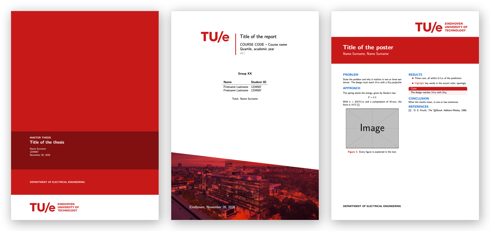
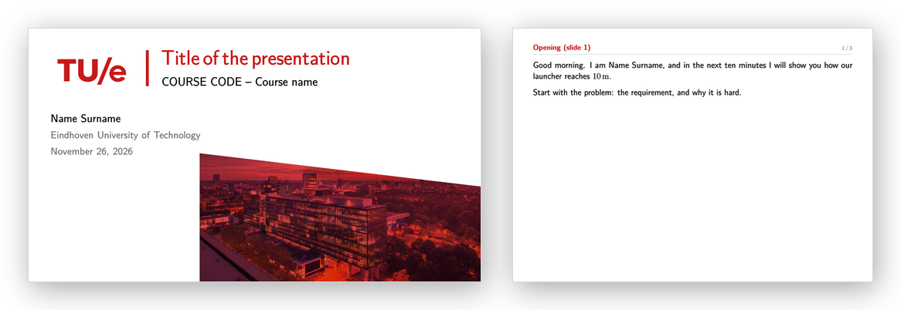
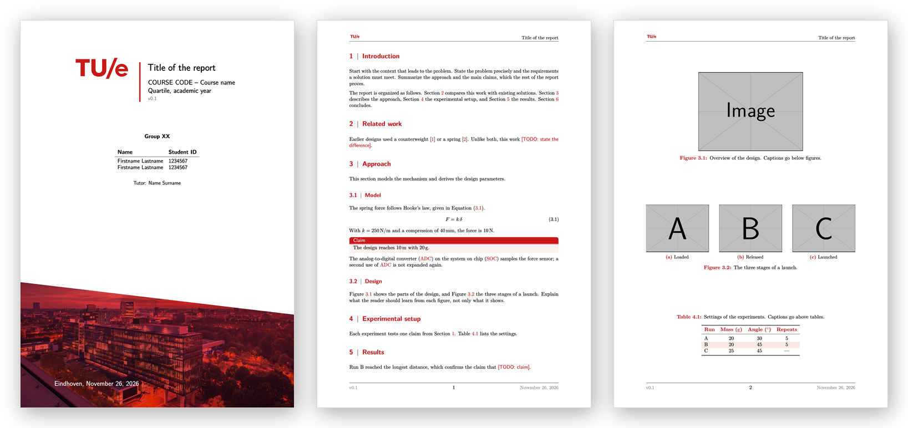
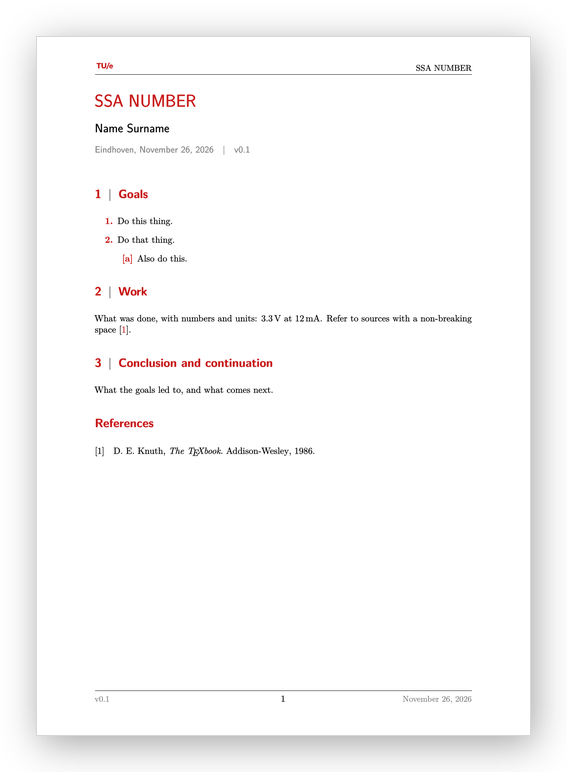
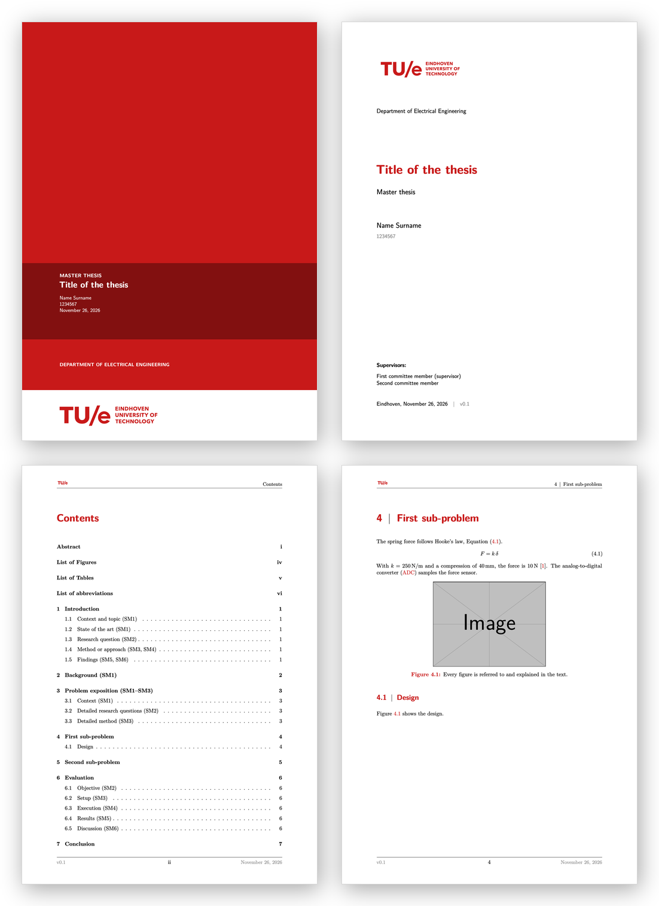
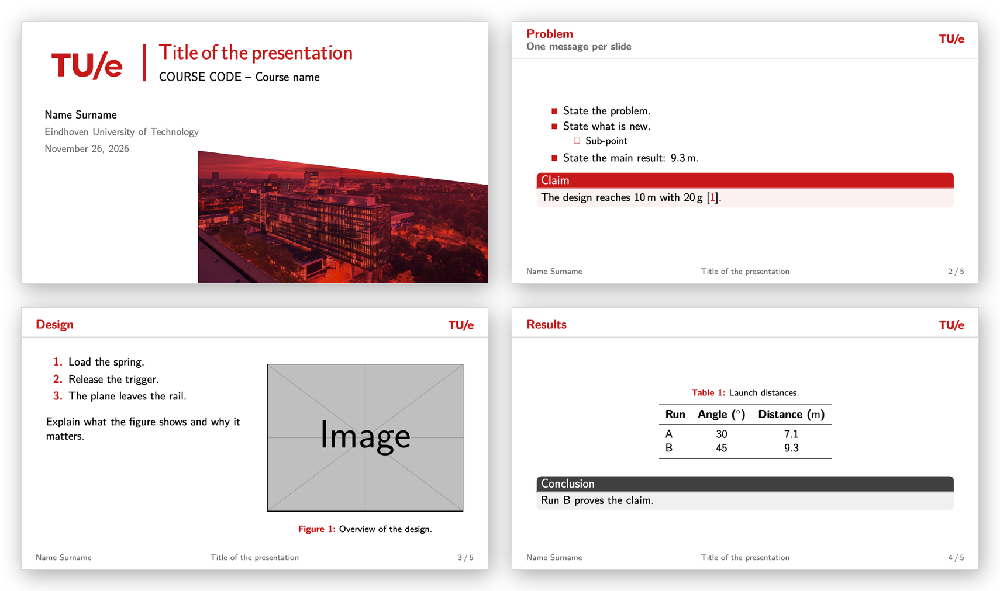
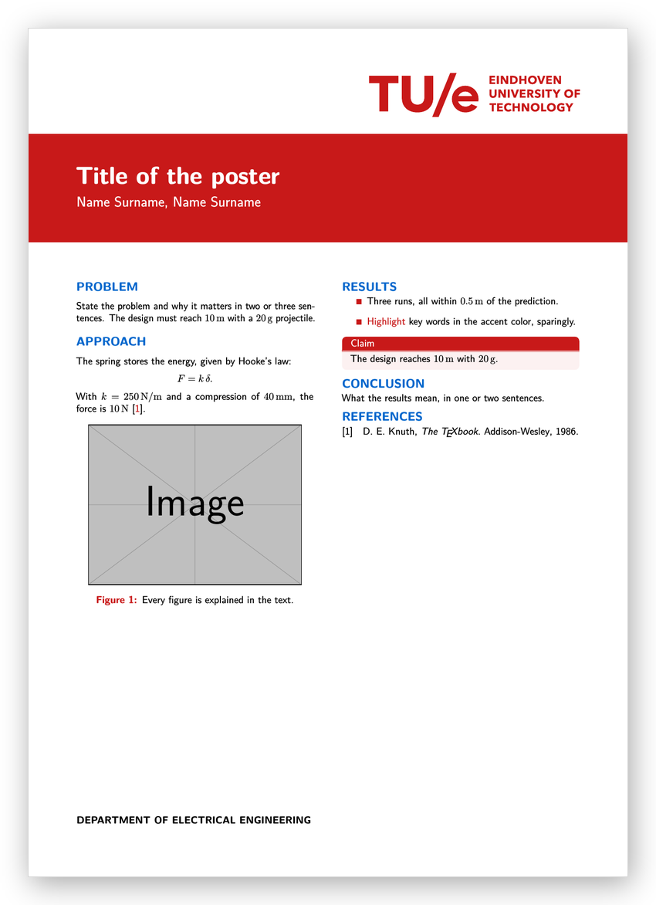
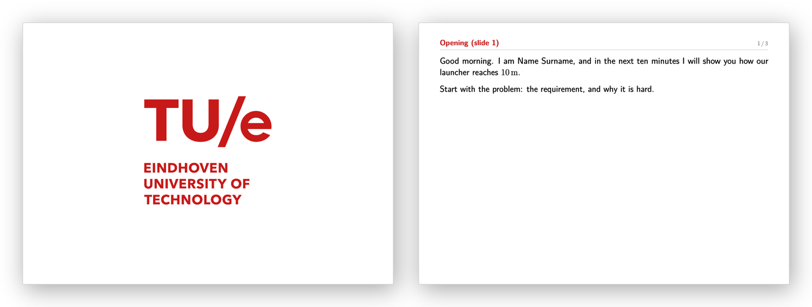
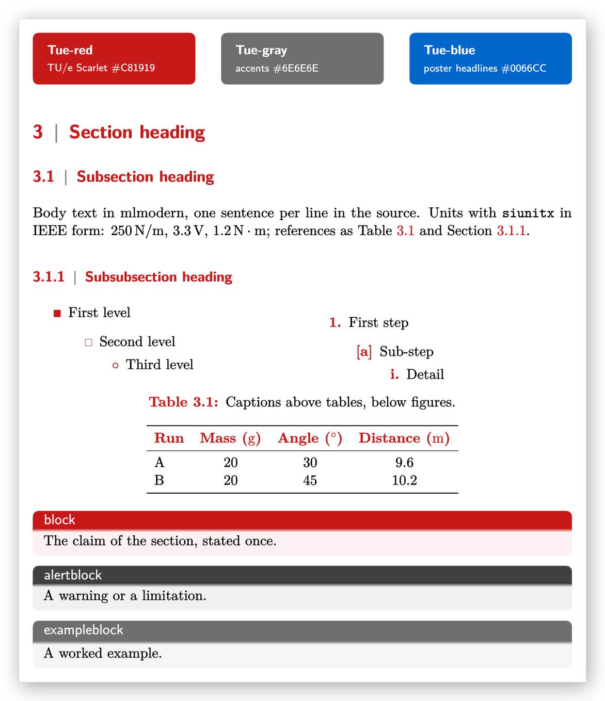
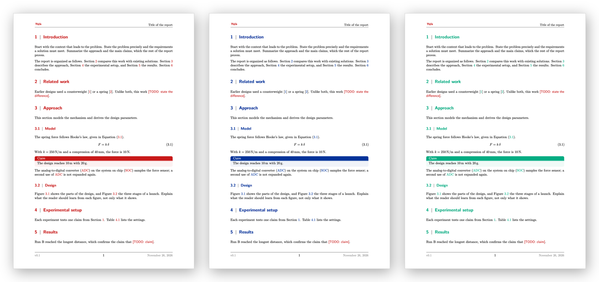

<h1 align="center">TU/e LaTeX templates</h1>

<p align="center">
  Reports, theses, slides, posters and cue cards in one house style:<br>
  TU/e Scarlet, sans-serif headings, IEEE references, built with <code>latexmk</code>, started with <code>copier</code>.
</p>

<p align="center">
  
</p>
<p align="center">
  
</p>

## Quick start

```sh
pipx install copier
copier copy --trust gh:ItsJupiter21/tue-latex-templates my-report
cd my-report && make                       # or open the folder in VS Code
```

Copier asks what you are making (CBL report, note, thesis, slides, poster, cue cards), the
title and the names, fills them into the document, and starts a git repo. Later,
`copier update` in the project pulls in style changes; your `.tex` and `references.bib` are
never touched. `--trust` lets copier run `fill.py`, which writes your answers into the
`.tex`; read it first if you like.

| | Folder | Text goes in | Follows |
|---|---|---|---|
| [CBL report](#cbl-report) | `cbl-report/` | `main.tex` | TU/e EE document guidelines |
| [Short note](#short-note) | `cbl-report/` | `note.tex` | TU/e EE document guidelines |
| [Thesis / personal report](#thesis-and-personal-reports) | `thesis/` | `thesis.tex` | TU/e EE report covers, TU/e thesis template |
| [Slides](#slides) | `beamer/` | `slides.tex` | TU/e beamer template |
| [Poster](#poster) | `poster/` | `poster.tex` | `tueposter2018`, TU/e poster directions |
| [Cue cards](#cue-cards) | `cuecards/` | `cuecards.tex` | TU/e "Speaker cue cards – 2 on 1 A4" |

`common/` holds the shared base style (`tuebase.sty`), the TU/e logos, the Makefile and the
editor settings; each template folder links to it. `texlive/` lists the TeX packages needed.

---

## CBL report

<p align="center"></p>

Group project report: cover with logo, title bar and campus banner; group table with names
and student IDs; abstract, contents, list of symbols and abbreviations; the body in the
paper structure (introduction, related work, approach, setup, results, conclusions);
references and appendix. Header with logo and title, footer with version, page and date.

## Short note

<p align="center"></p>

One-page-style note for SSAs, weekly or lab notes: a title block (title, name, date, version)
and numbered sections.

## Thesis and personal reports

<p align="center"></p>

Bachelor thesis, master thesis, internship report or any personal report. The front is the
TU/e EE report cover redrawn in TikZ at the sizes measured from the TU/e PDF: type, title,
subtitle, author, student number and date on a dark red band, the department, and the logo
bar. `\reportcoverimage{photo}` puts a photo behind it (cropped to fill; pick a dark one, or
add `\coverdarkentrue`); without one the cover is TU/e red. Then a title page with
supervisors, front matter in roman numbers, chapters as `N | Title`, a back cover with the
TU/e address (`\makebackcover`). Add `twoside` for printing and binding.

## Slides

<p align="center"></p>

16:9 beamer theme: title slide with logo and banner, slide titles in scarlet with the logo
top right, footer with author, title and slide number (backup slides after `\appendix` are
not counted). `make handout` builds a version without overlay steps.

## Poster

<p align="center"></p>

A4 design printed at A1 (2.83 ×) or A0 (4 ×), as TU/e's `tueposter2018`: logo bar, title bar,
two columns, headlines in caps blue, the department at the bottom. Use PDF graphics or
high-resolution images. With partners: `\dualbranding{logo}{color}` (bar in the partner's
color, white TU/e logo on it) or `\multibranding{logo1, logo2}` (60 % black bar). Figures in a
column: `\posterfigure[width]{file}{caption}`.

## Cue cards

<p align="center"></p>

Two A5 cards per A4 sheet. Side 1 is what the audience sees: the TU/e logo (as in the TU/e
cue card file), with an optional cue under it; `\cardlogo{file}` uses another logo,
`\cardlogo{}` none. Side 2 is your text, with a heading and the card number.

```latex
\begin{card}[spring -- latch]{The design (slide 2)}
  Point at the spring. The spring stores the energy; the latch releases it in one go.
\end{card}
```

Print **double-sided, flip on long edge, A4, actual size** and cut at the marks: each card's
text lands behind its own logo, both upright. Printer only flips on the short edge:
`\usepackage[flip=short]{tuecards}`. Too much text on a card stops the build with an error
instead of shrinking the font (shorten it, split it, or `\cardfontsize{12}{15}`).

---

## Style

<p align="center"></p>

| Color | Value | Used for |
|---|---|---|
| `Tue-red` | TU/e Scarlet, RGB 200-25-25, `#C81919` | logo, covers, title bars, `\todo` |
| `Tue-accent` | Scarlet unless set with `\accentcolor` | headings, chapter and section pages, bullets, captions, links, `block` |
| `Tue-gray` | `#6E6E6E` | secondary text, `exampleblock` |
| `Tue-blue` | PMS 300, `#0066CC` | poster headlines (the accent, when one is set) |

Text is mlmodern (a darker Latin Modern) with sans-serif headings; plain text stays black.

### Accent color

<p align="center"></p>

Uncomment the line in the preamble (or answer copier's *accent* question):

```latex
\accentcolor{HTML}{003399}        % or \accentcolor{RGB}{0, 51, 153}
```

The manual (pp. 8 and 18) keeps TU/e Scarlet as the main color and allows one **secondary
color** per publication as an accent for chapter pages, (sub)paragraph headings and color areas.
Take it from the cover image (the "coloring principle"). Use a full color with no tints, dark
enough for white text, and not a red close to Scarlet. The build warns when a color is too
pale or too close to Scarlet. The logo, covers and title bars stay Scarlet.

## Writing in the templates

- All text lives in one `.tex` file. Settings and packages are in the `.sty` files
  (`tuebase.sty` + `tuereport` / `tuethesis` / `tueposter` / `tuecards`, or
  `beamerthemeTUe.sty`), so the `.tex` stays plain text you can search.
- Document data: `\reporttitle`, `\reportsubtitle`, `\reportversion`, `\reportgroup`,
  `\reportauthors`, `\reportsupervisor`, `\reportcoverimage`, `\reportdate`, `\reportplace`
  (empty = no place), `\reportdepartment`, `\reportheader` / `\reportfooter` (header and footer
  right; default title / date); thesis also `\reporttype`, `\reportstudentid`.
- PDF properties are filled from the same data: title, author (the names from
  `\reportauthors`, ID column dropped), subject (subtitle or course; thesis: type and
  department), keywords (`\reportkeywords{a, b}`), language en-US.
- Writing rules and conventions (document guidelines, IEEE, TU/e): `WRITING.md`. The style already handles these:
  page numbers on every page and slide, the version in the footer, captions below figures and
  above tables, "Figure 3.1"/"Section 2.1"/"Appendix A" via `\cref`, units via `siunitx` in IEEE form (`\SI{250}{\newton\per\metre}` = 250 N/m, N·m),
  abbreviations via `acronym` (`\ac{SOC}`), embedded fonts.
- Boxes: `block`, `alertblock`, `exampleblock` work the same in every template
  (slides: beamer rounded blocks; the rest: tcolorbox copies of them).
- References: biblatex + biber in IEEE style (`biblatex-ieee`), numbered in order of citation.
  `@online` entries show the URL and the date accessed (`urldate`).


## make targets (all but beamer/)

| Target | Does |
|---|---|
| `make` | build every `.tex` in the folder (latexmk) |
| `make spell` | list words hunspell (en_US) does not know |
| `make lint` | chktex |
| `make release` | copy the PDF to `snapshots/YYYY-MM-DD_<title>_<version>.pdf` (tracked: commit the version you hand in); `DOC=note` picks one |
| `make clean` / `distclean` | remove build files / also the PDFs |

`beamer/`: `make`, `make handout` (no overlay steps), `make clean`.

## TeX installation

Any recent TeX Live (2024 or newer) or MiKTeX with `latexmk` and `biber` works; a full
install has every package. `texlive/packages.txt` lists the `.sty` files the templates need.

On Fedora, to install only those (not the full `texlive-*` set):
`texlive/install-packages.sh` reads `texlive/packages.txt` (file names such as `cleveref.sty`)
and installs the matching packages with `pkexec dnf install 'tex(<file>)'`. One password
dialog appears. To add a package, append its `.sty` name and re-run.

## TU/e brand identity

Checked against the TU/e *Visual Identity Manual* (V3, 2020-06-23) and the official TU/e
beamer, PowerPoint, poster, cue card and EE report cover templates. Those sources are not in
this repo; get them from TU/e.

- Color `Tue-red` = **TU/e Scarlet** RGB 200-25-25 (#C81919), used for the logo, headers and
  color areas. Plain text is black. An optional secondary color (`\accentcolor`, see
  [Accent color](#accent-color)) replaces it in headings, bullets and boxes.
- Logos in `common/figures/tue/`: the official files from the TU/e logo kit (*TUe LOGO SET
  complete*): basic, descriptor-line and descriptor-stack, RGB scarlet for screen and white,
  used with their bounding box (the protected space; nothing may go inside it) at measured
  sizes. Never recolored, never on photos. `tue-banner.pdf` is the campus photo from the TU/e
  beamer template.
- Poster title block: centered in the title bar (tueposter2018 hangs it 2 mm below
  the bar top). Departures from the guide, by choice: the font stays mlmodern (the guide says Noto Sans
  for LaTeX, the report covers Avenir Next), and the slides keep this layout instead of
  the official TU/e beamer layout (dark blue text on gray).

## Editors

- **VS Code** (`.vscode/` in each template folder): LaTeX Workshop builds with latexmk on save and
  shows the PDF in a tab (Ctrl+click jumps between source and PDF); LTeX+ checks spelling and grammar
  (`en-US`; color names, labels and units are
  skipped). Formats on save with `tex-fmt` (indentation only, no wrapping; installed with
  `cargo install tex-fmt`). Open the folder, not the file.
- `latexmkrc` in each folder makes every tool build a PDF with pdflatex and biber (never DVI), with
  SyncTeX. Jump source → PDF: Ctrl+Alt+J in VS Code; PDF → source: Ctrl+click in the PDF tab.
- **TeXstudio**: the `% !TeX program = latexmk` line at the top of each `.tex` makes F5 (Build & View)
  run latexmk, which also runs biber for the references.
- **KBibTeX** for `references.bib`: set it to BibLaTeX (Settings → General → Bibliography system)
  so `@online`, `url` and `urldate` are kept, and use AuthorYear keys (`knuth1986`).

## Maintaining the templates

- Copier hands out the newest version tag. After changing a template, tag and push a new
  version, or new projects keep getting the old one: `git tag v1.2.0 && git push --follow-tags`.
- A generated project is self-contained: the links to `common/` become real files.
- Commit in a project before running `copier update` in it.

### Screenshots

The images in `docs/img/` come from the template PDFs. After changing a style, run
`python3 docs/shots.py` (it rebuilds every document and `docs/style.tex`) and commit the images.

## License

The code (`.sty`, `.tex`, scripts, settings) is under the [MIT License](LICENSE).

The TU/e logos and the campus banner in `common/figures/tue/` belong to Eindhoven University
of Technology (the logos are its trademarks) and are **not** covered by that license. The logos
are the official files from the TU/e logo kit, the banner comes from the TU/e beamer template;
use them only as the TU/e visual identity allows, for TU/e work. This is a student
project, not an official TU/e template.
